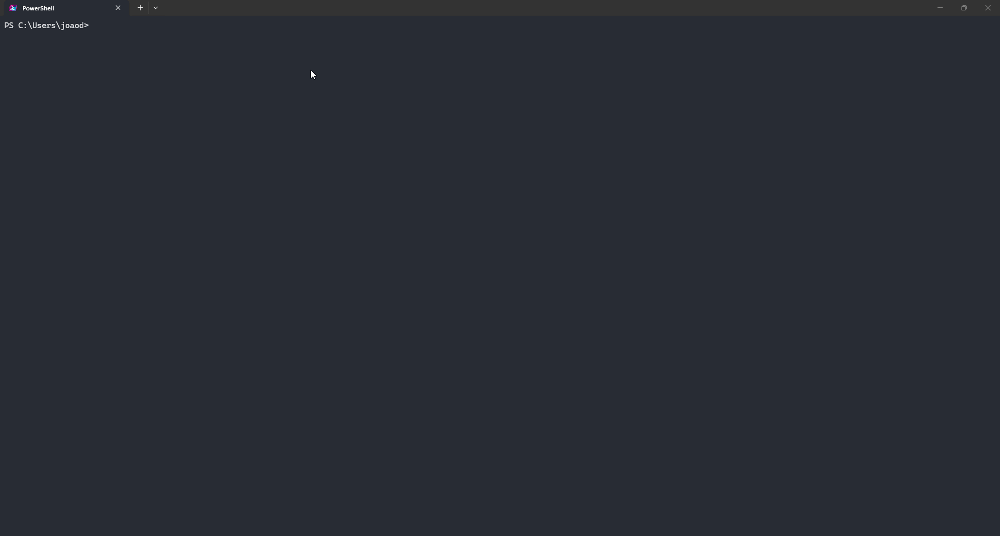

# Varedura

<p align="center">
  
</p>

<p align="center">
  <strong>Entorno de terminal para mantenimiento de Docker, diagnóstico de redes, puente de cámaras y servidor MCP.</strong><br />
  <em>Construido con GitHub Copilot CLI para el DEV Challenge.</em>
</p>

<p align="center">
  <a href="https://github.com/joaosnet/Varedura/blob/main/LICENSE"></a>
  <a href="https://github.com/joaosnet/Varedura"></a>
  <a href="https://github.com/joaosnet/Varedura"></a>
  <a href="https://dev.to/challenges/github-2026-01-21"></a>
</p>

<p align="center">
  <sub>Disponible en: <a href="README.md">English</a> · <a href="README.pt-BR.md">Português (pt-BR)</a> · <a href="README.es.md">Español</a></sub>
</p>

<p align="center">
  <a href="#instalación-rápida">Instalación</a> ·
  <a href="#módulos-principales">Módulos Principales</a> ·
  <a href="#servidor-mcp">Servidor MCP</a> ·
  <a href="#soporte-multiplataforma">Multiplataforma</a> ·
  <a href="#seguridad-y-operaciones">Seguridad</a> ·
  <a href="#estudio-de-caso-copilot-cli">Caso Copilot CLI</a>
</p>

---

## Instalación Rápida

### Instalación en una sola línea

**Windows (PowerShell)**:
```powershell
irm https://raw.githubusercontent.com/joaosnet/Varedura/main/install.ps1 | iex
```

**Linux / macOS (Bash)**:
```bash
curl -fsSL https://raw.githubusercontent.com/joaosnet/Varedura/main/install.sh | bash
```

El script de instalación analiza las herramientas locales (`uv`, `Docker`, `Git`), instala los componentes faltantes, detecta la configuración regional del sistema y agrega el ejecutable a la variable PATH.

Ejecute la interfaz desde cualquier terminal:
```bash
varedura
```

### Rutas alternativas de instalación

<details>
<summary><strong>Instalación mediante uv tool</strong></summary>

```bash
uv tool install git+https://github.com/joaosnet/Varedura.git --python ">=3.14"
```

Para actualizar una instalación editable o global existente:
```bash
uv tool upgrade varedura
```

</details>

<details>
<summary><strong>Clonar y ejecutar desde el código fuente</strong></summary>

```bash
git clone https://github.com/joaosnet/Varedura.git
cd Varedura
uv run main.py
```

</details>

<details>
<summary><strong>Ejecución headless vía CLI</strong></summary>

Ejecute módulos específicos directamente sin inicializar la interfaz gráfica Textual:

```bash
uv run python -m cli.quick_cleanup             # Limpieza rápida de Docker
uv run python -m cli.main_cleaner              # Pipeline completo de saneamiento
uv run python -m cli.admin_tasks compact_vhdx  # Compactación de VHDX en WSL2 (Admin)
```

</details>

<details>
<summary><strong>Desinstalación</strong></summary>

```powershell
# Windows
.\install.ps1 -Uninstall
```

```bash
# Linux / macOS
./install.sh --uninstall
```

O desinstale directamente mediante `uv`:
```bash
uv tool uninstall varedura
```

</details>

### Requisitos del Sistema

| Requisito | Ámbito | Notas |
|---|---|---|
| **Python ≥ 3.14** | Entorno base | Gestionado automáticamente por `uv` |
| **uv** | Gestor de paquetes y herramientas | Instalado por el script si no está presente |
| **Docker Engine / Desktop** | Limpieza de contenedores | Opcional; requerido para operaciones con contenedores |
| **Privilegios de Administrador / sudo** | Mantenimiento del sistema | Necesario para compactar discos VHDX en WSL2 y terminar procesos |

---

## Módulos Principales

```
Varedura
├── cli/              TUI Textual, gestión de teclado, fallback Rich
├── docker_cleaner/   Cliente Docker, integración WSL2, optimizador VHDX
├── monitor/          Monitor de latencia ICMP, escaneo de puertos, pruebas de velocidad
├── varedura/         Puente de cámaras, saneamiento RTSP, empaquetado HLS
├── mcp_server/       Servidor stdio del Model Context Protocol para IA
├── recorder/         Captura vectorial SVG y compilación a GIF animado
└── i18n/             Esquema bilingüe (pt-BR / en-US) con persistencia local
```

### Motor de Mantenimiento Docker

Origen: `docker_cleaner/core.py`, `cli/admin_tasks.py`

- Elimina contenedores detenidos, redes huérfanas, volúmenes sin uso y caché de compilación en una sola pasada.
- Permite saneamiento granular mediante selectores interactivos.
- En Windows, recupera espacio físico en disco ejecutando `wsl --shutdown` y aplicando `Optimize-VHD` sobre los discos virtuales de WSL2.
- Configura asignaciones dispersas en WSL para evitar el crecimiento desmedido de los archivos VHDX.
- Transmite la salida estándar de cada subproceso en tiempo real al panel de registros de la interfaz.

### Diagnóstico de Red y Stalker

Origen: `monitor/stalker.py`, `monitor/port_scanner.py`, `monitor/speed_tester.py`

- Monitorización continua de latencia ICMP registrando valores mínimos, máximos, promedios y fluctuación (jitter).
- Generación de gráficos sparkline en terminal para visualización inmediata de inestabilidades.
- Escaneo multihilo de puertos TCP/UDP correlacionando puertos abiertos con procesos y PIDs locales.
- Medición de ancho de banda mediante proveedores Speedtest.net y Fast.com.
- Evaluación de cumplimiento normativo frente a los estándares de la agencia reguladora ANATEL.
- Exportación de historiales y diagnósticos en formatos PDF y CSV.

### Puente Local de Cámaras

Origen: `varedura/camera_bridge.py`

- Convierte flujos de cámaras RTSP locales en capturas HTTP saneadas y transmisiones HLS bajo demanda.
- Diseñado para su consumo por aplicaciones locales de confianza (como *Mural dos Sonhos*).
- Elimina credenciales, direcciones IP y URLs originales de los manifiestos públicos.
- Mantiene sesiones activas mediante heartbeats con TTL y recupera instancias huérfanas de FFmpeg.

```powershell
varedura-camera-bridge --output-dir "C:\ruta\hacia\mural\runtime\cameras"
```

### Interfaz de Terminal y Grabación de Sesiones

Origen: `cli/textual_app.py`, `recorder/`

- Desarrollado sobre Textual con control completo por teclado, navegación estilo vim y redimensionamiento dinámico.
- Dispone de modo alternativo Rich accesible mediante `varedura --legacy-rich` o `VAREDURA_UI=rich`.
- Grabador integrado que captura el búfer del terminal en vectores SVG y genera archivos GIF optimizados.
- Mascota animada con estados discretos (Inactivo, Escaneando, Procesando, Error).

### Internacionalización

Origen: `i18n/`

- Detecta el idioma del sistema operativo en el primer arranque (`pt-BR` / `en-US`).
- Permite cambiar de idioma en cualquier momento desde los ajustes sin reiniciar el terminal.
- Conserva las preferencias del usuario en `~/.varedura_lang.json`.

---

## Servidor MCP

Varedura expone sus operaciones internas a través de un servidor local [Model Context Protocol (MCP)](https://modelcontextprotocol.io/). Esto permite a asistentes como GitHub Copilot CLI ejecutar diagnósticos y mantenimientos de forma directa.

### Configuración

Agregue el servidor a su archivo `.vscode/mcp.json` o perfil de agentes:

```json
{
  "servers": {
    "varedura": {
      "type": "stdio",
      "command": "uv",
      "args": ["run", "python", "-m", "mcp_server"]
    }
  }
}
```

### Herramientas Expuestas

| Herramienta | Parámetros | Descripción |
|---|---|---|
| `docker_status` | Ninguno | Informa consumo de disco, contenedores activos y recuento de imágenes |
| `docker_quick_cleanup` | Ninguno | Elimina contenedores detenidos, imágenes no etiquetadas y caché huérfana |
| `docker_full_cleanup` | Ninguno | Ejecuta saneamiento completo, detiene WSL y compacta archivos VHDX en Windows |
| `port_scan` | `target_host`, `ports` | Detecta puertos TCP/UDP en escucha y los asocia con procesos locales |
| `get_logs` | `lines` | Lee las últimas entradas registradas en el archivo de log activo |

### Flujos en Lenguaje Natural con Copilot CLI

```
Usuario: "Comprueba el uso de disco de Docker y lista los contenedores en ejecución."
Agente -> invoca varedura:docker_status

Usuario: "Identifica qué procesos están escuchando en los puertos del 8000 al 9000."
Agente -> invoca varedura:port_scan

Usuario: "Ejecuta una limpieza completa de Docker y compacta el disco virtual de WSL."
Agente -> invoca varedura:docker_full_cleanup
```

---

## Soporte Multiplataforma

| Funcionalidad | Windows | Linux | macOS |
|---|---|---|---|
| Motor de limpieza Docker | Completo | Completo | Completo |
| Finalización de procesos | `taskkill /F` | `systemctl` / `killall` | `killall` |
| Compactación VHDX de WSL2 | `Optimize-VHD` | N/A | N/A |
| Asignación dispersa en WSL | PowerShell WMI | N/A | N/A |
| Limpieza de directorios temporales | `%TEMP%` | `/tmp` | `/tmp` |
| Vaciado de papelera | PowerShell Shell.Application | N/A | N/A |
| Elevación de privilegios | UAC (`runas`) | `sudo` | `sudo` |
| Monitor Network Stalker | Completo | Completo | Completo |
| Servicio MCP | Stdio | Stdio | Stdio |
| Instalador en una línea | Script PowerShell | Script Shell | Script Shell |

> Las operaciones no soportadas en un sistema operativo específico informan de su omisión en los registros sin generar excepciones no controladas.

---

## Seguridad y Operaciones

Las rutinas de saneamiento destructivo exigen confirmaciones explícitas antes de su ejecución:

| Operación | Objetivo | Mecanismo de Salvaguarda |
|---|---|---|
| `docker system prune -af --volumes` | Objetos Docker sin utilizar | Requiere confirmación modal explícita antes de comenzar |
| Finalización de procesos | Demonios Docker bloqueados | Muestra la lista de PIDs afectados antes de enviar la señal |
| `wsl --shutdown` | Subsistema WSL | Advierte al usuario si existen sesiones activas de terminal |
| `Optimize-VHD` | Archivo de disco de WSL2 | Verifica elevación de Administrador y ausencia de bloqueos de lectura |

Para verificar la lógica de los módulos localmente sin riesgos:

```bash
uv run pytest tests/ -v
```

La suite de pruebas aísla las llamadas al sistema mediante subprocesos simulados y adaptadores ficticios de la API de Docker.

---

## Estudio de Caso Copilot CLI

Varedura fue desarrollado para el [GitHub Copilot CLI Challenge](https://dev.to/challenges/github-2026-01-21) empleando GitHub Copilot CLI como compañero principal de desarrollo en la definición arquitectónica, implementación base y pruebas.

### Hitos Clave de Implementación

1. **Arquitectura de Subprocesos y Elevación**
   Copilot CLI colaboró en el diseño de la capa de abstracción entre el UAC de PowerShell y el comando `sudo` de Unix, aislando las particularidades de cada sistema operativo en ejecutores específicos (`cli/admin_tasks.py`).

2. **Pipelines Síncronos y Asíncronos**
   Para preservar la fluidez de la interfaz Textual durante la eliminación de volúmenes pesados de Docker, Copilot CLI estructuró una cola asíncrona que canaliza la salida de los comandos hacia los controladores de eventos sin bloquear la pantalla.

3. **Diseño del Servidor MCP vía Stdio**
   La implementación de Model Context Protocol se basó en el estándar oficial, utilizando Copilot CLI para mapear las rutinas internas a herramientas JSON-RPC 2.0 sobre stdio, lo que permite su invocação inmediata por agentes inteligentes.

4. **Estrategia de Pruebas y Mocks**
   Copilot CLI generó fixtures en `pytest` (`tests/`) que simulan el demonio de Docker, fluctuaciones en la red y bloqueos del sistema de archivos, permitiendo validar las reglas de seguridad sin alterar el entorno del desarrollador.

---

## Licencia

MIT. Consulte [LICENSE](LICENSE) para más detalles.
