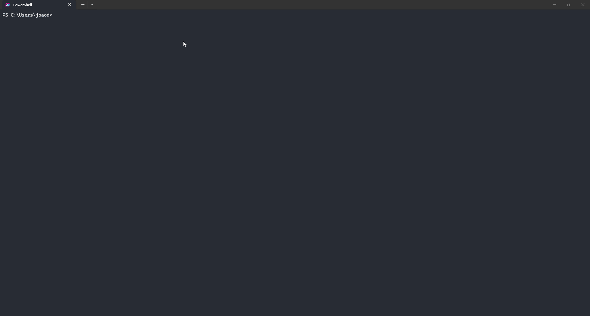

# Varedura

<p align="center">
  
</p>

<p align="center">
  <strong>Terminal workspace for Docker maintenance, network diagnostics, camera bridging, and MCP agent tooling.</strong><br />
  <em>Built with GitHub Copilot CLI for the DEV Challenge.</em>
</p>

<p align="center">
  <a href="https://github.com/joaosnet/Varedura/blob/main/LICENSE"></a>
  <a href="https://github.com/joaosnet/Varedura"></a>
  <a href="https://github.com/joaosnet/Varedura"></a>
  <a href="https://dev.to/challenges/github-2026-01-21"></a>
</p>

<p align="center">
  <sub>Available in: <a href="README.md">English</a> · <a href="README.pt-BR.md">Português (pt-BR)</a> · <a href="README.es.md">Español</a></sub>
</p>

<p align="center">
  <a href="#quick-install">Install</a> ·
  <a href="#core-modules">Core Modules</a> ·
  <a href="#mcp-server">MCP Server</a> ·
  <a href="#cross-platform-support">Cross-Platform</a> ·
  <a href="#safety-and-operations">Safety</a> ·
  <a href="#copilot-cli-case-study">Copilot CLI Case Study</a>
</p>

---

## Quick Install

### One-liner setup

**Windows (PowerShell)**:
```powershell
irm https://raw.githubusercontent.com/joaosnet/Varedura/main/install.ps1 | iex
```

**Linux / macOS (Bash)**:
```bash
curl -fsSL https://raw.githubusercontent.com/joaosnet/Varedura/main/install.sh | bash
```

The installer verifies local dependencies (`uv`, `Docker`, `Git`), installs missing components, detects system locale, and configures the executable in your path.

Launch the interface from any terminal:
```bash
varedura
```

### Alternative installation paths

<details>
<summary><strong>Install via uv tool</strong></summary>

```bash
uv tool install git+https://github.com/joaosnet/Varedura.git --python ">=3.14"
```

Update an existing editable or tool installation:
```bash
uv tool upgrade varedura
```

</details>

<details>
<summary><strong>Clone and run from source</strong></summary>

```bash
git clone https://github.com/joaosnet/Varedura.git
cd Varedura
uv run main.py
```

</details>

<details>
<summary><strong>Headless CLI execution</strong></summary>

Run specific modules directly without initializing the Textual UI:

```bash
uv run python -m cli.quick_cleanup             # Docker prune without TUI
uv run python -m cli.main_cleaner              # Full cleanup pipeline
uv run python -m cli.admin_tasks compact_vhdx  # WSL2 disk compaction (Windows Admin)
```

</details>

<details>
<summary><strong>Uninstallation</strong></summary>

```powershell
# Windows
.\install.ps1 -Uninstall
```

```bash
# Linux / macOS
./install.sh --uninstall
```

Or remove directly through `uv`:
```bash
uv tool uninstall varedura
```

</details>

### System Requirements

| Requirement | Scope | Notes |
|---|---|---|
| **Python ≥ 3.14** | Core runtime | Provisioned automatically by `uv` |
| **uv** | Package and tool manager | Bootstrapped by the install script if absent |
| **Docker Engine / Desktop** | Docker cleaner | Optional; needed for container prune and metrics |
| **Elevated privileges (Admin / sudo)** | System maintenance | Required for WSL2 VHDX compaction and process termination |

---

## Core Modules

```
Varedura
├── cli/              Textual TUI, keyboard routing, legacy Rich fallback
├── docker_cleaner/   Docker engine client, WSL2 integration, VHDX optimizer
├── monitor/          ICMP latency stalker, port scanner, speedtest providers
├── varedura/         Camera bridge, RTSP sanitizer, HLS packager
├── mcp_server/       Model Context Protocol stdio service for AI agents
├── recorder/         Terminal session SVG capture and GIF generator
└── i18n/             Bilingual schema (pt-BR / en-US) with runtime persistence
```

### Docker Maintenance Engine

Source: `docker_cleaner/core.py`, `cli/admin_tasks.py`

- Prunes stopped containers, unused networks, dangling volumes, and build cache in a single run.
- Supports targeted cleanup through interactive selectors.
- Reclaims physical disk space on Windows by issuing `wsl --shutdown` and running `Optimize-VHD` against WSL2 virtual drives.
- Configures sparse WSL disk allocations to prevent unbounded VHDX growth.
- Streams subprocess output line-by-line into the TUI log panel.

### Network Diagnostics & Stalker

Source: `monitor/stalker.py`, `monitor/port_scanner.py`, `monitor/speed_tester.py`

- Continuous ICMP latency monitor recording min, max, average, and jitter values.
- Renders rolling terminal sparkline charts for visual degradation detection.
- Multi-threaded TCP/UDP port scanner matching open ports to running processes and PIDs.
- Internet bandwidth verification via Speedtest.net and Fast.com providers.
- Evaluates upload and download metrics against Brazilian ANATEL regulatory targets.
- Exports diagnostic runs to PDF and CSV formats.

### Local Camera Bridge

Source: `varedura/camera_bridge.py`

- Converts local RTSP camera endpoints into sanitized HTTP snapshots and on-demand HLS streams.
- Designed for local visualization consumers (such as *Mural dos Sonhos*).
- Strips credentials, network hosts, and raw URLs from public metadata manifests.
- Maintains single-client session leases with heartbeat TTL sweeps and orphan FFmpeg process reclamation.

```powershell
varedura-camera-bridge --output-dir "C:\path\to\mural\runtime\cameras"
```

### Terminal UI & Session Recording

Source: `cli/textual_app.py`, `recorder/`

- Built on Textual with full keyboard control, vim-style navigation, and dynamic layout resizing.
- Includes legacy Rich interface mode accessible via `varedura --legacy-rich` or `VAREDURA_UI=rich`.
- Embedded session recorder captures terminal frames into SVG vectors and compiles them into animated GIF files.
- Built-in status mascot with discrete state transitions (Idle, Scanning, Working, Error).

### Internationalization

Source: `i18n/`

- Automatically reads system locale on initial start (`pt-BR` / `en-US`).
- Switch languages on demand from the settings screen without terminal restart.
- Persists user preferences to `~/.varedura_lang.json`.

---

## MCP Server

Varedura exposes its core operations through a local [Model Context Protocol (MCP)](https://modelcontextprotocol.io/) server. This allows AI assistants such as GitHub Copilot CLI to run maintenance tasks and query system state directly.

### Configuration

Add the server to your VS Code MCP definition (`.vscode/mcp.json`) or agent profile:

```json
{
  "servers": {
    "varedura": {
      "type": "stdio",
      "command": "uv",
      "args": ["run", "python", "-m", "mcp_server"]
    }
  }
}
```

### Exposed Tools

| Tool | Parameters | Description |
|---|---|---|
| `docker_status` | None | Returns Docker disk consumption, container states, and image inventory |
| `docker_quick_cleanup` | None | Prunes exited containers, dangling images, and dangling build cache |
| `docker_full_cleanup` | None | Runs complete prune, stops WSL, and compacts Windows VHDX files |
| `port_scan` | `target_host`, `ports` | Identifies listening TCP/UDP ports and maps them to local processes |
| `get_logs` | `lines` | Reads the latest entries from the active Varedura log file |

### Natural Language Workflows

When configured in Copilot CLI:

```
User: "Check Docker disk utilization and list running containers."
Agent -> calls varedura:docker_status

User: "Find which processes are listening on ports 8000 through 9000."
Agent -> calls varedura:port_scan

User: "Execute full Docker cleanup and compact WSL virtual disk."
Agent -> calls varedura:docker_full_cleanup
```

---

## Cross-Platform Support

| Capability | Windows | Linux | macOS |
|---|---|---|---|
| Docker prune engine | Full | Full | Full |
| Process termination | `taskkill /F` | `systemctl` / `killall` | `killall` |
| WSL2 VHDX compaction | `Optimize-VHD` | N/A | N/A |
| WSL sparse allocation | PowerShell WMI | N/A | N/A |
| Temp directory cleanup | `%TEMP%` | `/tmp` | `/tmp` |
| Recycle bin purge | PowerShell Shell.Application | N/A | N/A |
| Privilege elevation | UAC (`runas`) | `sudo` | `sudo` |
| Network Stalker | Full | Full | Full |
| MCP Service | Stdio | Stdio | Stdio |
| One-line install | PowerShell script | Shell script | Shell script |

> Operations unsupported on a specific platform exit gracefully with informative log output rather than unhandled exceptions.

---

## Safety and Operations

Destructive cleanup routines enforce strict guardrails:

| Operation | Target | Safeguard |
|---|---|---|
| `docker system prune -af --volumes` | All unused Docker objects | Explicit modal prompt required before execution |
| Process termination | Hanging Docker daemons | Confirms PID list prior to dispatch |
| `wsl --shutdown` | WSL subsystem | Warns user of running terminal sessions |
| `Optimize-VHD` | WSL2 disk file | Checks for Administrator elevation and read locks |

Run unit tests locally to verify cleanup logic against mock targets:

```bash
uv run pytest tests/ -v
```

All test cases isolate destructive operations through mock subprocesses and fake Docker API adapters.

---

## Copilot CLI Case Study

Varedura was developed for the [GitHub Copilot CLI Challenge](https://dev.to/challenges/github-2026-01-21) using GitHub Copilot CLI as the primary pair programmer across architecture design, core implementation, and testing.

### Key Implementation Milestones

1. **Subprocess and Elevation Architecture**
   Copilot CLI generated the abstraction layer coordinating Windows PowerShell UAC prompts with Unix `sudo` workflows, isolating platform-specific syntax into dedicated executors (`cli/admin_tasks.py`).

2. **Dual Synchronous and Asynchronous Pipelines**
   To keep the Textual TUI responsive while executing multi-gigabyte Docker volume deletions, Copilot CLI structured an async queue that streams stdout lines into Textual message handlers without blocking event loops.

3. **MCP Stdio Server Design**
   The Model Context Protocol integration was implemented from specification using Copilot CLI to map internal helper functions into JSON-RPC 2.0 stdio tool definitions, enabling zero-configuration tool calls for Copilot CLI agents.

4. **Testing and Mock Strategies**
   Copilot CLI constructed unit and integration test fixtures (`tests/`) mocking Docker daemon responses, network latency spikes, and file system locks, enabling full test coverage without modifying host machines.

---

## License

MIT. See [LICENSE](LICENSE) for details.
