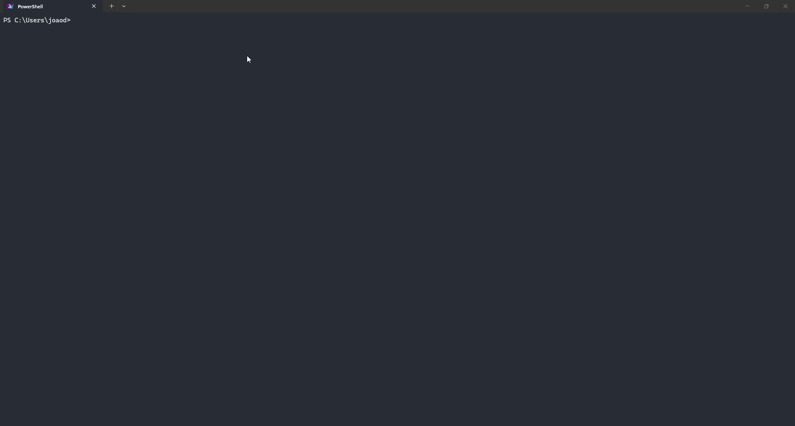

# Varedura

<p align="center">
  
</p>

<p align="center">
  <strong>Cross-platform Textual terminal workspace (Windows, Linux, macOS &amp; Android/Termux) for Docker/WSL2 maintenance, network diagnostics &amp; repairs, IP camera discovery/bridging with Edge AI, Termux hub &amp; self-updater, and MCP tooling.</strong>
</p>

<p align="center">
  <a href="LICENSE"></a>
  
  
</p>

<p align="center">
  <sub>Read in: <a href="README.md">English</a> · <a href="README.pt-BR.md">Português (pt-BR)</a></sub>
</p>

---

## Quick Start

### One-line install

**Windows (PowerShell)**:
```powershell
irm https://raw.githubusercontent.com/joaosnet/Varedura/main/install.ps1 | iex
```

**Linux / macOS (Bash)**:
```bash
curl -fsSL https://raw.githubusercontent.com/joaosnet/Varedura/main/install.sh | bash
```

**Android / Termux (Bash)**:
```bash
bash scripts/termux_install.sh
```
Or sync directly from a Windows PC over ADB + SSH:
```powershell
.\scripts\sync_termux_adb.ps1 -Install
```

Launch the Textual TUI:
```bash
varedura
```

### Run from source (`uv`)

```bash
git clone https://github.com/joaosnet/Varedura.git
cd Varedura
uv sync --dev
uv run main.py
```

### Entrypoints

| Command | Purpose | Guide |
|---|---|---|
| `varedura` / `uv run main.py` | Unified Textual TUI (Dashboard, conditional Docker, Network, Cameras, Termux, Settings + native SVG screenshots) | [docs/docker-e-cli.md](docs/docker-e-cli.md) |
| `varedura-update` / `uv run python -m varedura.updater` | Authenticated Git self-updater (`GHG_TOKEN`/`~/.varedura_gh_token`), 6h cooldown & optional cron sync | [docs/termux.md](docs/termux.md) |
| `varedura-camera-bridge --output-dir <dir>` | Sanitized RTSP snapshot/HLS bridge for local consumers (*Mural dos Sonhos*) | [docs/cameras-e-ia.md](docs/cameras-e-ia.md) |
| `uv run python -m mcp_server` | Stdio Model Context Protocol (MCP) server for AI agents | [docs/mcp.md](docs/mcp.md) |
| `uv run python -m cli.quick_cleanup` | Headless Docker prune + WSL shutdown + VHDX compaction | [docs/docker-e-cli.md](docs/docker-e-cli.md) |

---

## What's Inside

| Subsystem | Packages / Paths | Summary |
|---|---|---|
| **Docker & Textual TUI** | `docker_cleaner/`, `cli/`, `i18n/` | Sync/async Docker prune, Windows WSL2 sparse & VHDX compaction, unified Textual TUI (conditional Docker tab on Android/Termux), native SVG screenshot capture (`screenshots/`), PT/EN i18n |
| **Network Suite** | `monitor/` | Continuous multi-target ICMP stalker, ANATEL-style PDF/CSV export, pure `compute_health_score` (`network_health.py`), root-cause diagnostics, confirmed repairs, port scanner, multi-provider speedtest, LoL match detector |
| **Termux & Self-Updater** | `varedura/termux_env.py`, `varedura/updater.py`, `scripts/` | Android telemetry, tool/shortcut/Claro suite hub, background service toggles, `Termux:API` notifications/sharing, Android players (`vlc-android`, `termux-open`, `mpv --vo=tct`), `varedura-update` |
| **Cameras & Edge AI** | `rtsp/`, `varedura/camera_bridge.py`, `varedura/ai_vision/` | Unified RTSP/iCSee/NetIP/Sofia P2P/ONVIF engine, local LAN scanner, sanitized HLS bridge, YOLO ONNX + geometric rules (`LineCrossing`, `ZoneIntrusion`, `Loitering`, heatmap) |
| **MCP Server** | `mcp_server/` | Stdio FastMCP service (`docker_status`, `docker_quick_cleanup`, `docker_full_cleanup`, `port_scan`, `get_logs`) with confirmation gates |

---

## System Requirements

| Requirement | Scope | Notes |
|---|---|---|
| **Python ≥ 3.14.2 + `uv`** | Core runtime (desktop) | Managed automatically by `uv` (`pyproject.toml` declares `[build-system]`); on Termux ARM64 use `scripts/termux_install.sh` |
| **Docker Engine / Desktop** | Docker cleaner | Optional; the `docker` tab is hidden automatically on Android/Termux when `docker` is absent |
| **Admin / `sudo` / root** | System & repairs | Needed for VHDX compaction, process stop, and OS network repairs |
| **FFmpeg / MPV / VLC / Chrome** | Optional extras | FFmpeg/MPV/VLC for camera playback & snapshots; Termux:API for Android alerts/share; Chrome/Selenium (`browser-speedtest`) for SIMET/BBL |

---

## Documentation

Full guides (in Portuguese) live in `docs/`, designed for fast human onboarding and low-token navigation:

| Document | When to read |
|---|---|
| [docs/arquitetura.md](docs/arquitetura.md) | How the subsystems fit together, lazy startup flow, entrypoints, and local state files |
| [docs/manutencao.md](docs/manutencao.md) | Dev setup (`uv`), running tests & `ruff`, CI checks, logging, safety boundaries, `graphify`, and troubleshooting |
| [docs/como-adicionar-recursos.md](docs/como-adicionar-recursos.md) | Step-by-step recipes to add Docker steps, TUI tabs/modals, network probes/repairs, Termux tools, MCP tools, or AI rules |
| [docs/docker-e-cli.md](docs/docker-e-cli.md) | `WSLDockerCleaner` sync/async model, Textual TUI, conditional Docker tab, native SVG screenshots, i18n + line-range index |
| [docs/rede.md](docs/rede.md) | Ping scheduler, diagnostics engine, safe repairs, port catalog, multi-provider speedtest, ANATEL PDFs + line-range index |
| [docs/cameras-e-ia.md](docs/cameras-e-ia.md) | `rtsp/` protocols (RTSP, NetIP/P2P, ONVIF), sanitized `camera_bridge`, YOLO ONNX & spatial rules + line-range index |
| [docs/termux.md](docs/termux.md) | Android/Termux installation, ADB+SSH sync, tool auto-discovery, Android camera playback, `Termux:API`, and `varedura-update` |
| [docs/mcp.md](docs/mcp.md) | Stdio MCP configuration, the 5 exposed tools, and two-step safety confirmation (`dry_run` → `confirmed`) |
| [AGENTS.md](AGENTS.md) | Canonical agent map: low-token analysis rules, module table, invariants, and ignore boundaries |

---

## Safety & License

Destructive operations (Docker `system prune --volumes`, `wsl --shutdown`, `Optimize-VHD`, OS network repairs) require explicit user confirmation; MCP cleanup tools enforce `dry_run` / `confirmed=True` guardrails; `varedura-update` never writes GitHub tokens into `.git/config` or logs; and `varedura-camera-bridge` strips RTSP credentials before publishing metadata. All test suites mock external system calls.

Originally built for the DEV GitHub Copilot CLI Challenge (archived background in [docs/arquivo/POST-SUBMISSION.md](docs/arquivo/POST-SUBMISSION.md)).  
Licensed under the **MIT License** — see [LICENSE](LICENSE).
