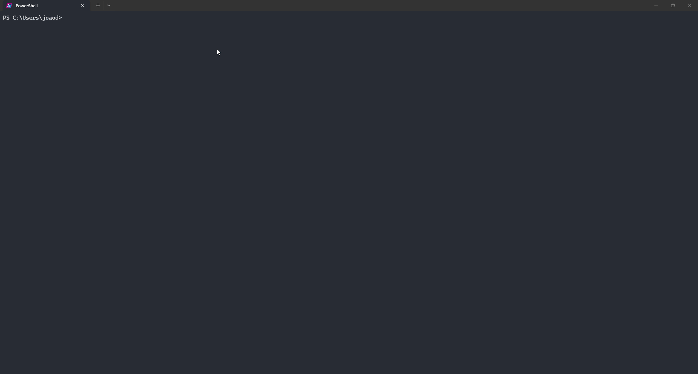

# Varedura

<p align="center">
  
</p>

<p align="center">
  <strong>Interface de terminal para manutenção Docker, diagnóstico de rede, ponte de câmeras e servidor MCP.</strong><br />
  <em>Construído com GitHub Copilot CLI para o DEV Challenge.</em>
</p>

<p align="center">
  <a href="https://github.com/joaosnet/Varedura/blob/main/LICENSE"></a>
  <a href="https://github.com/joaosnet/Varedura"></a>
  <a href="https://github.com/joaosnet/Varedura"></a>
  <a href="https://dev.to/challenges/github-2026-01-21"></a>
</p>

<p align="center">
  <sub>Disponível em: <a href="README.md">English</a> · <a href="README.pt-BR.md">Português (pt-BR)</a> · <a href="README.es.md">Español</a></sub>
</p>

<p align="center">
  <a href="#instalação-rápida">Instalação</a> ·
  <a href="#módulos-principais">Módulos Principais</a> ·
  <a href="#servidor-mcp">Servidor MCP</a> ·
  <a href="#suporte-multiplataforma">Multiplataforma</a> ·
  <a href="#segurança-e-operações">Segurança</a> ·
  <a href="#estudo-de-caso-copilot-cli">Case Copilot CLI</a>
</p>

---

## Instalação Rápida

### Instalação em uma linha

**Windows (PowerShell)**:
```powershell
irm https://raw.githubusercontent.com/joaosnet/Varedura/main/install.ps1 | iex
```

**Linux / macOS (Bash)**:
```bash
curl -fsSL https://raw.githubusercontent.com/joaosnet/Varedura/main/install.sh | bash
```

O instalador verifica dependências do sistema (`uv`, `Docker`, `Git`), instala componentes ausentes, detecta o idioma local e adiciona o executável ao seu PATH.

Inicie a aplicação a partir de qualquer terminal:
```bash
varedura
```

### Métodos alternativos de instalação

<details>
<summary><strong>Instalação via uv tool</strong></summary>

```bash
uv tool install git+https://github.com/joaosnet/Varedura.git --python ">=3.14"
```

Para atualizar uma instalação existente:
```bash
uv tool upgrade varedura
```

</details>

<details>
<summary><strong>Clonar e executar do código-fonte</strong></summary>

```bash
git clone https://github.com/joaosnet/Varedura.git
cd Varedura
uv run main.py
```

</details>

<details>
<summary><strong>Execução headless via CLI</strong></summary>

Execute módulos específicos diretamente sem carregar a interface gráfica Textual:

```bash
uv run python -m cli.quick_cleanup             # Prune rápido do Docker
uv run python -m cli.main_cleaner              # Pipeline completo de limpeza
uv run python -m cli.admin_tasks compact_vhdx  # Compactação de VHDX do WSL2 (Admin)
```

</details>

<details>
<summary><strong>Desinstalação</strong></summary>

```powershell
# Windows
.\install.ps1 -Uninstall
```

```bash
# Linux / macOS
./install.sh --uninstall
```

Ou remova diretamente pelo `uv`:
```bash
uv tool uninstall varedura
```

</details>

### Requisitos do Sistema

| Requisito | Escopo | Observações |
|---|---|---|
| **Python ≥ 3.14** | Runtime principal | Gerenciado automaticamente pelo `uv` |
| **uv** | Gerenciador de pacotes e ferramentas | Instalado pelo script se ausente |
| **Docker Engine / Desktop** | Módulo de limpeza | Opcional; necessário para tarefas de container |
| **Privilégios de Administrador / sudo** | Manutenção do sistema | Necessário para compactar VHDX no WSL2 e encerrar processos |

---

## Módulos Principais

```
Varedura
├── cli/              TUI Textual, atalhos de teclado, fallback Rich
├── docker_cleaner/   Cliente Docker, integração WSL2, otimizador VHDX
├── monitor/          Monitor de latência ICMP, port scanner, testes de velocidade
├── varedura/         Ponte de câmeras, sanitização RTSP, empacotador HLS
├── mcp_server/       Servidor stdio do Model Context Protocol para IA
├── recorder/         Captura vetorial SVG e exportação em GIF
└── i18n/             Esquema bilíngue (pt-BR / en-US) com persistência local
```

### Motor de Manutenção Docker

Origem: `docker_cleaner/core.py`, `cli/admin_tasks.py`

- Remove containers parados, redes órfãs, volumes não utilizados e cache de build em um único ciclo.
- Permite limpeza seletiva por meio de menus interativos.
- No Windows, recupera espaço físico em disco executando `wsl --shutdown` e `Optimize-VHD` nos discos virtuais do WSL2.
- Configura alocação esparsa no WSL para conter o crescimento contínuo do VHDX.
- Transmite a saída dos subprocessos linha por linha diretamente no painel de logs da interface.

### Diagnóstico de Rede & Stalker

Origem: `monitor/stalker.py`, `monitor/port_scanner.py`, `monitor/speed_tester.py`

- Monitoramento contínuo de latência ICMP calculando métricas de mínimo, máximo, média e jitter.
- Renderização de gráficos sparkline no terminal para identificação visual de instabilidades.
- Varredura multi-thread de portas TCP/UDP correlacionando portas abertas com processos e PIDs locais.
- Testes de largura de banda via provedores Speedtest.net e Fast.com.
- Avaliação de conformidade das velocidades com as metas regulatórias da ANATEL.
- Exportação dos diagnósticos nos formatos PDF e CSV.

### Ponte Local de Câmeras

Origem: `varedura/camera_bridge.py`

- Converte fluxos RTSP de câmeras de segurança locais em snapshots HTTP e streams HLS sob demanda.
- Projetado para integração com aplicações locais confiáveis (como o *Mural dos Sonhos*).
- Remove credenciais, endereços IP e URLs originais dos manifestos públicos.
- Controla sessões ativas por meio de heartbeats com TTL e encerra instâncias órfãs do FFmpeg.

```powershell
varedura-camera-bridge --output-dir "C:\caminho\para\mural\runtime\cameras"
```

### Interface de Terminal & Gravação de Sessões

Origem: `cli/textual_app.py`, `recorder/`

- Construído sobre a biblioteca Textual, com controle por teclado, navegação em estilo vim e redimensionamento dinâmico.
- Modo alternativo legado em Rich disponível via `varedura --legacy-rich` ou `VAREDURA_UI=rich`.
- Gravador integrado que captura o terminal em vetores SVG e gera arquivos GIF otimizados.
- Mascote de status com estados discretos (Ocioso, Escaneando, Processando, Erro).

### Internacionalização

Origem: `i18n/`

- Detecta o idioma do sistema operacional no primeiro início (`pt-BR` / `en-US`).
- Permite alternar o idioma a qualquer momento na tela de configurações sem reiniciar o terminal.
- Salva as preferências em `~/.varedura_lang.json`.

---

## Servidor MCP

O Varedura expõe suas funcionalidades operacionais por meio de um servidor local [Model Context Protocol (MCP)](https://modelcontextprotocol.io/). Isso permite que ferramentas de IA, como o GitHub Copilot CLI, executem diagnósticos e manutenções diretamente.

### Configuração

Adicione a definição do servidor ao seu `.vscode/mcp.json` ou perfil de agentes:

```json
{
  "servers": {
    "varedura": {
      "type": "stdio",
      "command": "uv",
      "args": ["run", "python", "-m", "mcp_server"]
    }
  }
}
```

### Ferramentas Disponíveis

| Ferramenta | Parâmetros | Descrição |
|---|---|---|
| `docker_status` | Nenhum | Retorna consumo de disco, containers em execução e contagem de imagens |
| `docker_quick_cleanup` | Nenhum | Remove containers encerrados, imagens e cache de build órfãos |
| `docker_full_cleanup` | Nenhum | Executa limpeza geral, encerra o WSL e compacta arquivos VHDX no Windows |
| `port_scan` | `target_host`, `ports` | Identifica portas TCP/UDP em escuta e relaciona com processos locais |
| `get_logs` | `lines` | Lê as linhas mais recentes do arquivo de log ativo |

### Exemplos no GitHub Copilot CLI

```
Usuário: "Verifique o uso de disco do Docker e liste containers ativos."
Agente -> invoca varedura:docker_status

Usuário: "Quais processos estão escutando nas portas de 8000 a 9000?"
Agente -> invoca varedura:port_scan

Usuário: "Execute a limpeza completa do Docker e compacte o disco do WSL."
Agente -> invoca varedura:docker_full_cleanup
```

---

## Suporte Multiplataforma

| Funcionalidade | Windows | Linux | macOS |
|---|---|---|---|
| Limpeza Docker | Completo | Completo | Completo |
| Encerramento de processos | `taskkill /F` | `systemctl` / `killall` | `killall` |
| Compactação VHDX do WSL2 | `Optimize-VHD` | N/A | N/A |
| Alocação esparsa no WSL | PowerShell WMI | N/A | N/A |
| Limpeza de diretórios temp | `%TEMP%` | `/tmp` | `/tmp` |
| Esvaziamento de lixeira | PowerShell Shell.Application | N/A | N/A |
| Elevação de privilégios | UAC (`runas`) | `sudo` | `sudo` |
| Monitor Network Stalker | Completo | Completo | Completo |
| Servidor MCP | Stdio | Stdio | Stdio |
| Instalador em uma linha | Script PowerShell | Script Shell | Script Shell |

> Operações não suportadas em determinado sistema operacional exibem mensagens informativas nos logs sem gerar exceções não tratadas.

---

## Segurança e Operações

Rotinas de limpeza destrutiva exigem validações explícitas antes de qualquer execução:

| Operação | Alvo | Medida de Proteção |
|---|---|---|
| `docker system prune -af --volumes` | Objetos Docker não utilizados | Exige confirmação explícita em modal antes de iniciar |
| Encerramento de processos | Daemons Docker travados | Exibe a lista de PIDs afetados antes do envio do sinal |
| `wsl --shutdown` | Subsistema WSL | Alerta o usuário caso haja sessões de terminal ativas |
| `Optimize-VHD` | Arquivo de disco do WSL2 | Valida elevação de Administrador e ausência de travas de leitura |

Para verificar a lógica dos módulos localmente sem risco:

```bash
uv run pytest tests/ -v
```

A suíte de testes isola chamadas de sistema através de subprocessos simulados e adaptadores mock da API do Docker.

---

## Estudo de Caso Copilot CLI

O Varedura foi desenvolvido para o [GitHub Copilot CLI Challenge](https://dev.to/challenges/github-2026-01-21) usando o GitHub Copilot CLI como parceiro de desenvolvimento em todas as fases de arquitetura, implementação e testes.

### Etapas Centrais de Desenvolvimento

1. **Arquitetura de Subprocessos e Elevação**
   O Copilot CLI auxiliou na estruturação da camada de compatibilidade entre o UAC do PowerShell e o `sudo` do Unix, encapsulando comandos específicos de plataforma em executores dedicados (`cli/admin_tasks.py`).

2. **Pipelines Síncronos e Assíncronos**
   Para manter a interface Textual responsiva durante a exclusão de volumes extensos do Docker, o Copilot CLI organizou uma fila assíncrona que envia a saída do terminal para o event loop sem travamentos de tela.

3. **Implementação do Protocolo MCP via Stdio**
   A integração com o Model Context Protocol foi construída mapeando as rotinas internas para especificações JSON-RPC 2.0 sobre stdio, permitindo invocação imediata de ferramentas por agentes autônomos.

4. **Estratégia de Testes e Mocks**
   O Copilot CLI gerou fixtures de teste (`tests/`) simulando respostas do daemon Docker, latências de rede e bloqueios de arquivos, viabilizando a validação de regras de segurança sem modificar o computador do desenvolvedor.

---

## Licença

MIT. Consulte [LICENSE](LICENSE) para detalhes.
