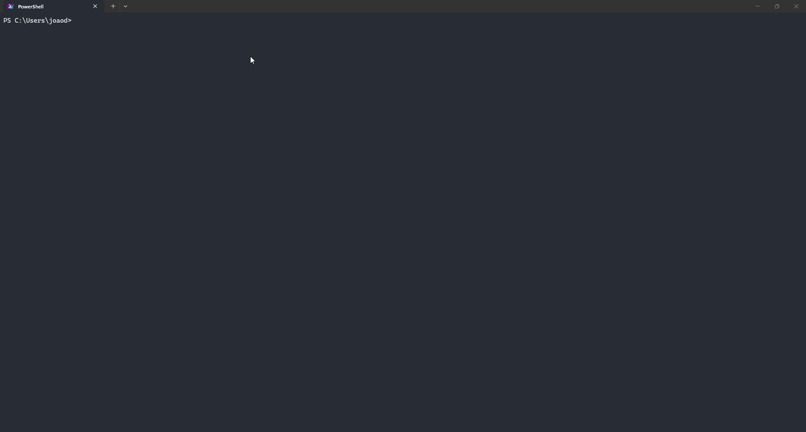

# Varedura

<p align="center">
  
</p>

<p align="center">
  <strong>Workspace Textual multiplataforma (Windows, Linux, macOS e Android/Termux) para manutenção Docker/WSL2, diagnóstico e reparo de rede, descoberta/ponte de câmeras IP com visão AI, hub Termux, auto-atualização e servidor MCP.</strong>
</p>

<p align="center">
  <a href="LICENSE"></a>
  
  
</p>

<p align="center">
  <sub>Leia em: <a href="README.md">English</a> · <a href="README.pt-BR.md">Português (pt-BR)</a></sub>
</p>

---

## Início Rápido

### Instalação em uma linha

**Windows (PowerShell)**:
```powershell
irm https://raw.githubusercontent.com/joaosnet/Varedura/main/install.ps1 | iex
```

**Linux / macOS (Bash)**:
```bash
curl -fsSL https://raw.githubusercontent.com/joaosnet/Varedura/main/install.sh | bash
```

**Android / Termux (Bash)**:
```bash
bash scripts/termux_install.sh
```
Ou sincronize direto do PC Windows via ADB + SSH:
```powershell
.\scripts\sync_termux_adb.ps1 -Install
```

Inicie a TUI Textual:
```bash
varedura
```

### Executar a partir do código-fonte (`uv`)

```bash
git clone https://github.com/joaosnet/Varedura.git
cd Varedura
uv sync --dev
uv run main.py
```

### Pontos de entrada

| Comando | Finalidade | Guia |
|---|---|---|
| `varedura` / `uv run main.py` | TUI Textual unificada (Dashboard, Docker condicional, Rede, Câmeras, Termux, Ajustes + captura SVG nativa) | [docs/docker-e-cli.md](docs/docker-e-cli.md) |
| `varedura-update` / `uv run python -m varedura.updater` | Auto-atualização Git autenticada (`GHG_TOKEN`/`~/.varedura_gh_token`), cooldown 6h e cron | [docs/termux.md](docs/termux.md) |
| `varedura-camera-bridge --output-dir <dir>` | Ponte sanitizada de snapshots/HLS para consumidores locais (*Mural dos Sonhos*) | [docs/cameras-e-ia.md](docs/cameras-e-ia.md) |
| `uv run python -m mcp_server` | Servidor stdio Model Context Protocol (MCP) para agentes de IA | [docs/mcp.md](docs/mcp.md) |
| `uv run python -m cli.quick_cleanup` | Limpeza Docker headless + shutdown do WSL + compactação VHDX | [docs/docker-e-cli.md](docs/docker-e-cli.md) |

---

## O que há no projeto

| Subsistema | Pacotes / Pastas | Resumo |
|---|---|---|
| **Docker & TUI Textual** | `docker_cleaner/`, `cli/`, `i18n/` | Prune Docker sync/async, WSL2 sparse e compactação VHDX no Windows, UI Textual única (aba Docker condicional no Android/Termux), captura nativa SVG (`screenshots/`), i18n PT/EN |
| **Suíte de Rede** | `monitor/` | Stalker ICMP multi-alvo contínuo, exportação PDF estilo ANATEL/CSV, `compute_health_score` puro (`network_health.py`), diagnóstico de causa raiz, reparos confirmados, port scanner, speedtest multi-provedor e detector de LoL |
| **Termux & Auto-Updater** | `varedura/termux_env.py`, `varedura/updater.py`, `scripts/` | Telemetria Android, hub de ferramentas/atalhos/Claro, serviços em segundo plano, notificações e compartilhamento `Termux:API`, players Android (`vlc-android`, `termux-open`, `mpv --vo=tct`), `varedura-update` |
| **Câmeras & Visão AI** | `rtsp/`, `varedura/camera_bridge.py`, `varedura/ai_vision/` | Motor unificado RTSP/iCSee/NetIP/Sofia P2P/ONVIF, scanner LAN, ponte HLS sanitizada, YOLO ONNX + regras espaciais (`LineCrossing`, `ZoneIntrusion`, `Loitering`, heatmap) |
| **Servidor MCP** | `mcp_server/` | Serviço FastMCP stdio (`docker_status`, `docker_quick_cleanup`, `docker_full_cleanup`, `port_scan`, `get_logs`) com travas de confirmação |

---

## Requisitos de Sistema

| Requisito | Escopo | Observações |
|---|---|---|
| **Python ≥ 3.14.2 + `uv`** | Runtime principal (desktop) | Provisionado pelo `uv` (`pyproject.toml` declara `[build-system]`); no Termux ARM64 use `scripts/termux_install.sh` |
| **Docker Engine / Desktop** | Limpador Docker | Opcional; a aba `docker` é ocultada automaticamente no Android/Termux quando o `docker` não está instalado |
| **Privilégios Admin / `sudo` / root** | Sistema e reparos | Necessário para `Optimize-VHD`, encerrar processos e reparos de rede |
| **FFmpeg / MPV / VLC / Chrome** | Extras opcionais | FFmpeg/MPV/VLC para reprodução e snapshots; Termux:API para alertas/compartilhamento no Android; Chrome/Selenium (`browser-speedtest`) para SIMET/BBL |

---

## Documentação

Os guias completos estão em `docs/`, organizados para facilitar a leitura por humanos e reduzir o consumo de tokens por agentes:

| Documento | Quando consultar |
|---|---|
| [docs/arquitetura.md](docs/arquitetura.md) | Visão geral dos subsistemas, startup lazy, pontos de entrada e mapa de arquivos persistidos |
| [docs/manutencao.md](docs/manutencao.md) | Setup com `uv`, testes e `ruff`, CI, logs, limites de segurança, manutenção do `graphify` e troubleshooting |
| [docs/como-adicionar-recursos.md](docs/como-adicionar-recursos.md) | Receitas passo a passo para adicionar etapas Docker, abas/modais TUI, probes/reparos, ferramentas Termux, ferramentas MCP ou regras AI |
| [docs/docker-e-cli.md](docs/docker-e-cli.md) | Modelo sync/async do `WSLDockerCleaner`, TUI Textual, aba Docker condicional, capturas SVG nativas, i18n + índice de linhas |
| [docs/rede.md](docs/rede.md) | Escalonador de ping, motor de diagnóstico, reparos seguros, catálogo de portas, speedtest e PDFs ANATEL + índice de linhas |
| [docs/cameras-e-ia.md](docs/cameras-e-ia.md) | Protocolos `rtsp/` (RTSP, NetIP/P2P, ONVIF), ponte sanitizada `camera_bridge`, YOLO ONNX e regras espaciais + índice de linhas |
| [docs/termux.md](docs/termux.md) | Instalação no Android/Termux, sync ADB+SSH, descoberta de ferramentas, players Android, `Termux:API` e `varedura-update` |
| [docs/mcp.md](docs/mcp.md) | Configuração stdio do MCP, as 5 ferramentas expostas e fluxo seguro em 2 passos (`dry_run` → `confirmed`) |
| [AGENTS.md](AGENTS.md) | Mapa canônico para agentes: análise com `graphify`, tabela de módulos, invariantes e exclusões |

---

## Segurança e Licença

Operações destrutivas (`docker system prune --volumes`, `wsl --shutdown`, `Optimize-VHD`, reparos de rede do SO) exigem confirmação explícita; as ferramentas destrutivas do MCP impõem `dry_run` / `confirmed=True`; o `varedura-update` nunca grava tokens GitHub em `.git/config` ou logs; e o `varedura-camera-bridge` remove credenciais RTSP antes de publicar metadados. A suíte de testes isola chamadas de sistema com mocks.

Originalmente desenvolvido para o DEV GitHub Copilot CLI Challenge (contexto histórico em [docs/arquivo/POST-SUBMISSION.md](docs/arquivo/POST-SUBMISSION.md)).  
Licenciado sob a **Licença MIT** — consulte [LICENSE](LICENSE).
